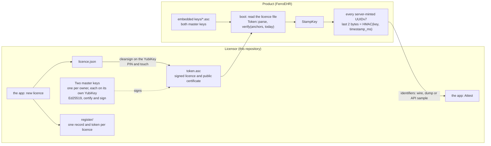
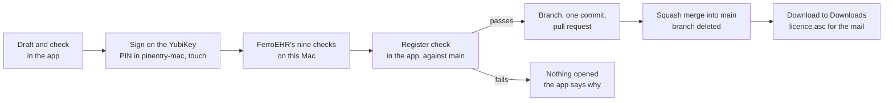

# Design

The commercial licence mechanism for FerroEHR, end to end. This file is the
design authority for this repository. `research.md` holds the evidence
behind each decision; `threat-model.md` lists what each attempt against the
mechanism leaves behind; `manuals/` are the runbooks, one per task;
`ferroehr-integration.md` is the contract for the product side.

## 1. Goals and non-goals

FerroEHR is source-available under the Business Source License 1.1.
Production use in the course of a business needs a commercial licence from
the licensor. The mechanism has four goals:

1. **A licence is a verifiable fact.** A licensee holds a token that proves,
   offline and without contacting anyone, that the licensor granted them
   production use for a period.
2. **Production data is self-describing.** Every identifier the product
   mints carries a mark that says which licence, or that none, was in force
   when the record was written. The mark cannot be removed without
   destroying the data.
3. **The product never changes behaviour.** No feature, endpoint, limit or
   message depends on a licence. A clinical system must never degrade
   because a file expired.
4. **No cost.** No network call, no table, no index, no extra byte stored,
   no measurable time per request.

Non-goals, deliberately:

- Preventing unlicensed use. Source-available software cannot be gated
  against someone who edits the source. The goal is evidence, not a lock.
- Feature entitlements, seat counts, hardware binding. The licence grants
  one thing: commercial production use for a period.
- Online activation, telemetry, phone-home. None.
- Revocation lists. See the decision log.

## 2. Components



Three pieces of code:

- `FerroLicenceKit` (a local Swift package): `LicenceCore` holds the licence
  document, the token envelope, the nine checks FerroEHR runs, the stamp and
  the attestation statistics, pure and with no I/O; it agrees with
  FerroEHR's checker on a shared file of test vectors. `Register` is the
  register in memory and every change to it, including the Register check.
  `Signing` wraps GnuPG for every key operation. `GitHubKit` reads and writes
  the repository through the GitHub API (§12).
- `FerroLICENCE`, the macOS app over the kit (§12).
- the product's `licence` module (FerroEHR): config key, boot verification,
  one log line, one status field, the stamp in identifier minting.

## 3. The licence document

Six fields, canonical pretty JSON in declaration order, one trailing
newline, no tabs, no trailing whitespace (the cleartext signature format
strips trailing whitespace, so none may carry meaning):

```json
{
  "licence_id": "0192a7e1-6f3c-7c0a-9b1e-3d5f2a8c4e10",
  "licensee": "Example Hospital NV",
  "issued": "2026-09-11",
  "not_before": "2026-09-11",
  "not_after": "2027-09-10",
  "use": "commercial"
}
```

- `licence_id` is a UUIDv7 minted at issue time. It is the stamp key
  material and the register key.
- Dates are civil dates in UTC, both ends inclusive.
- `use` has two values: `commercial` (a paid grant for production use in the
  course of a business) and `non-commercial` (what BUSL-1.1 gives everyone;
  the token every product build embeds carries it, so a deployment without
  its own token still runs under an explicit, signed licence). The reader is
  strict: an unknown field or an unknown use refuses the document. Adding a
  field later is a format version bump, not a silent extension.

## 4. The token

One ASCII-armored file, two OpenPGP blocks in order:

1. `-----BEGIN PGP SIGNED MESSAGE-----` … `-----END PGP SIGNATURE-----`: the
   licence JSON as a cleartext signature (RFC 9580 §7), made by a master
   key itself, hash SHA-512.
2. `-----BEGIN PGP PUBLIC KEY BLOCK-----` … `-----END PGP PUBLIC KEY BLOCK-----`:
   the issuer's full public certificate (RFC 9580 §10.1): the master key,
   its user id and self-signature, and the encryption and authentication
   subkeys the YubiKey generated beside it, which play no part here.

The licensee can read what they hold. The product embeds only the primary
key packets; the bundled certificate carries the self-signature that says
the key may sign.

## 5. Verification

`ferrolicence_core::verify::verify(token, anchors, today)`, in this order,
each step a typed refusal:

1. The bundled certificate's **primary key packet equals an anchor's**
   byte for byte. Not a fingerprint string: the full key material.
   Otherwise `UntrustedPrimary`. From here on only the **anchor** counts;
   the rest of the bundled certificate is never read, so a token cannot
   bring an older or altered state of the key with it.
2. The anchor's **self-signatures and every binding verify** under its
   primary (`BrokenBindings`).
3. The signed block carries **exactly one signature** (`NoSignature`,
   `ExtraSignatures`), and it is a **text signature** (type 0x01, what a
   cleartext signature is made with; `NotTextSignature`). Every following
   check judges that signature, the same one the cryptography verifies.
4. It names the **primary itself** as its issuer (fingerprint subpacket,
   or key id for v4). A signature by any other key, a subkey of the same
   certificate included, is refused (`UnknownSigner`).
5. The anchor's newest self-signature grants the **signing** flag
   (`NotSigningCapable`).
6. The signature's creation time precedes the key's **expiry**, if the
   anchor's self-signature sets one (`ExpiredAtSigning`). Master keys are
   generated without expiry, so this binds only a key someone gives one
   later.
7. The **signature verifies** over the normalised text (`BadSignature`).
8. The text **parses strictly** as a licence (`Payload`).
9. `today` lies inside `[not_before, not_after]` (`NotYetValid`, `Expired`).

Anchors are the certificates parsed from `keys/*.asc`. The product embeds
the same files and parses them at boot.

## 6. Keys

Two master keys, one per owner of the licensor (Cadasto B.V.), each
generated on its holder's YubiKey 5:

- **Ed25519**, v4, capabilities *certify* and *sign*, no expiry. The card
  generates it (`gpg --card-edit`, `generate`) and never lets it out, so no
  copy exists anywhere else. Every signature needs the card's PIN
  (`forcesig`) and a touch.
- **Both are anchors.** Their public certificates sit under `keys/`, and
  the product embeds both. Either owner issues alone with their own key;
  the register records which key signed each licence and `signers.json`
  names its holder.
- **No backup.** Each key is the other's backup. A lost or broken card
  loses no licence: what it signed keeps verifying, because the token
  carries its certificate and the product keeps the anchor. The other owner
  keeps issuing, and the holder generates a new key on a new card, which
  the next product release adds.

Trusting a key (the last step of the YubiKey setup in the app) exports its
public certificate to `keys/` and names its holder in `signers.json`; it runs
on the holder's computer and refuses a key whose secret is not on a card in
that keyring, or one that is not an Ed25519 signing key. Signing uses the key
on the YubiKey plugged in now, read from the card itself
(`gpg --card-status`), and only when that key is under `keys/`. Nothing ever
accepts a key on disk.

Retiring a key. The verifier compares only primary key packets with its
anchors and reads nothing else from `keys/`, so a key stops being trusted
only when a product release drops it. A stolen card is protected by its PIN
(three tries) and the touch; a key that must no longer be trusted moves to
`keys/retired/`, the next release drops it, and the licences it signed are
reissued with the other key.

The first key. The ceremony of 2026-09-11 made a certify-only primary
(`5834C101…5F712E51`) with a signing subkey in a software keyring. It was
retired on 2026-10-07: the embedded non-commercial token was re-minted with
a master key, the certificate moved to `keys/retired/`, and the keyring was
destroyed the same day.

Why OpenPGP rather than a bare Ed25519 signature over JSON: the product
already carries rPGP for version signing, so the envelope costs no new
dependency; OpenPGP gives the certificate transport for free; and GnuPG
can generate the key on a hardware token and sign with it there, so no
secret material ever passes through our own code.

Why GnuPG signs and our own code verifies: two independent implementations
agreeing on every token is an interoperability proof. FerroEHR verifies with
rPGP; this repository verifies with `LicenceCore` (CryptoKit), and the GnuPG
interop tests run GnuPG-signed tokens through it on every push.

## 7. The stamp

RFC 9562 §5.7 lays a version-7 UUID out as 48 bits of millisecond
timestamp, 4 version bits, 12 bits `rand_a`, 2 variant bits, 62 bits
`rand_b`. The `uuid` crate (and PostgreSQL's `uuidv7()`) fill the leading
part of the 74 pseudorandom bits with a monotonic counter and the rest with
CSPRNG output. **The last two bytes of the UUID are CSPRNG output under
every counter width the crate offers**, so the stamp goes there:

```
bytes[14..16] = HMAC-SHA256(key, timestamp_ms.to_be_bytes())[0..2]
```

- `key` is `"ferroehr/licence/v1/" ‖ licence_id` (16 raw bytes) when a
  licence verified at boot, else the public constant
  `"ferroehr/unlicensed/v1"`.
- `timestamp_ms` is the identifier's own 48-bit timestamp, so the stamp is
  different on every millisecond and a set of identifiers shows no fixed
  pattern, yet anyone with the key recomputes it exactly.
- Cost: one HMAC over eight bytes with a precomputed key schedule
  (`StampKey` holds the keyed state; stamping clones it), tens of
  nanoseconds. No column, no index, no extra byte, no query touched.
- The counter, sub-millisecond ordering and index locality are untouched.
  46 CSPRNG bits remain beside the counter. RFC 9562 §6.9 asks for a CSPRNG
  for unguessability and sets no minimum; we keep more entropy than
  PostgreSQL's own `uuidv7()` does after its sub-millisecond counter.

Which identifiers: every UUIDv7 the server mints. In FerroEHR today that is
EHR ids, versioned-object ids, contribution ids, audit ids and attestation
ids (`ferroehr-integration.md` §3). Client-supplied ids pass through
unstamped; that is a documented boundary, not a hole (`threat-model.md`).

What the stamp is not: a secret. The unlicensed key is a public constant and
every licence id is printed in its token. Its value is indelibility: the
versioned-object id is the openEHR identity of a record, referenced from
contributions, audits, folders and every client that ever fetched it.
Rewriting it destroys the database. And its absence on a FerroEHR-shaped
database proves the build was altered.

## 8. Attestation

The app's Attest tab reads any text (a dump, a log, an API response), pulls
out every UUID, and for each candidate key (the unlicensed constant and
every register entry) counts the version-7 identifiers whose last two bytes
equal the key's stamp for their own timestamp. Under the null hypothesis
each match is a Bernoulli trial with probability 2⁻¹⁶, so the count is
Binomial(n, 2⁻¹⁶) and its upper tail is the p-value. Twenty identifiers with
twenty matches give p ≈ 10⁻⁹⁶. The default identification threshold is
10⁻⁹.

This is the detection test of Agrawal and Kiernan's relational watermarking
(VLDB 2002) applied to identifier entropy (`research.md` §4).

The report also gives the time range of matching identifiers (from their
own timestamps), how many were minted after the candidate licence's
`not_after`, and, for a licence the register revoked, how many were minted
on or after the revocation's effective day. Since a sample can be taken over ITS-REST, attestation needs no
database access.

## 9. Product behaviour

Identical under either grant. Every build embeds the licensor's
`non-commercial` token and public certificate as string constants in the
`licence` module. At boot the product verifies the configured `[licence]
file` first and the embedded token second, logs one INFO line
(`licence: <licensee> (<use>, configured|embedded) until <date>`, with
`; configured token not in force: <reason>` appended when a configured token
was refused), exposes the public summary on `GET /rest/status`
(`licence: {state, use, licensee, not_after, configured_token}`), and selects
the stamp key from the licence in force. A configured token that is missing,
malformed, expired or tampered is never an error: the embedded grant stays in
force and the status says `configured_token: refused`. The only way to run
with no licence at all is a build whose embedded token does not verify, which
a unit test makes unshippable; such a build mints with a fail-safe key. The
verification runs once; the clock read is the server's.

## 10. Legal framing

The stamp is evidence, not proof. BUSL-1.1 permits non-commercial
production, so an unlicensed stamp on a production database is a reason to
ask, not a finding. A licence stamp on a database owned by someone other than
the licensee, or minted after `not_after`, is a stronger indicator and still
a conversation first.

The commercial licence agreement names the mechanism: FerroEHR marks
identifiers with the licence id, and the licensor may inspect for it. An
agreed, disclosed mechanism is admissible; a hidden one is the first thing
opposing counsel attacks. This is also why the product side is plainly
named and documented at the honest minimum (`ferroehr-integration.md` §6).

## 12. The app

A native macOS app, FerroLICENCE (SwiftUI, macOS 27, Apple Silicon), signed
in with GitHub through the FerroLICENCE GitHub App (`docs/github-app.md`).
It reads the register from GitHub and writes every change as a pull
request; nobody needs a clone or a terminal.



The sidebar has Customers and Activity, Check a File and Attest Data, and
Keys:

- **Customers**: who needs attention (a licence ending within 60 days, or
  ended in the last 90 with nothing after it), then every customer. The
  detail shows the licence that speaks for the customer today, its pull
  request, Download to Downloads, Revoke, and every earlier licence. New licence
  and renew start here, in a sheet: Draft, Check, Sign, then Recording.
- **Activity**: the register's history as sentences, one per merged pull
  request labelled `licence`, `revocation` or `key`, each linked to GitHub.
- **Check a File**: a licence file judged as FerroEHR judges it at boot
  (§5), with the check it stopped at. It works offline.
- **Attest Data**: a sample of identifiers matched to the register (§8).
- **Keys**: the trusted and retired keys with their holders, the YubiKey in
  this Mac, Trust a New Key, Stop Using a Key, and Set Up a YubiKey in its
  own window.

Every write has a check step before it. Issuing asks for the PIN and a
touch, which is the confirmation; revoking, which has no PIN, asks for the
word `REVOKE`; trusting a new key asks for `TRUST`; stopping a key asks for
`HANDOVER`, `LOST` or `RETIRE`. Cancel before that
step leaves nothing behind. GnuPG asks for every PIN in its pinentry-mac
window, so the app never sees one.

**Recording.** The app creates the files of the change and first runs the
Register check (`RegisterCheck.check`) on them, against the register's
`main` as a fresh sync has it: only new licence folders with a licence that
passes all nine checks under the keys `main` trusts and a record that
matches it, only a `revocation.json` added beside a licence, or a key change
of the kinds the app makes, recorded from the right GitHub account. When it
refuses, nothing is opened and the app says why. When it passes, the app
writes one commit on a new branch (`licence/<customer>-<first-day>-<id>`,
`revocation/…` or `key/…`), opens a pull request whose description lists the
terms, squash-merges it as the person signed in and deletes the branch.
The register lives in its own private repository,
`FerroHEALTH/FerroLICENCE-register`, which runs no CI: its `main` ruleset
takes only pull requests and signed commits, refuses force pushes and
deleting `main`, and needs no review (owners, 2026-10-24). There is no
review: the person who drafted the licence also checked it and signed it on
their YubiKey. Who may issue is `signers.json`: the
app recognises a key holder by their GitHub login there; anyone else with
access can check, attest and read Activity.

**Key holder and GitHub account.** Each key in `signers.json` names its
holder's GitHub login, and the two are bound on both sides. The app signs
only when the YubiKey plugged in holds the key of the person signed in. The
Register check compares the GitHub account recording the change with
`signers.json` as `main` has it (owners, 2026-10-24): a new licence may be recorded only from
the GitHub account of the holder whose key signed it; a revocation, a new
key, or a key marked handed over, lost or retired, from the account of any active key
holder; a GitHub login given to a key, only from that login. So the app
records no licence from a GitHub account without its holder's YubiKey and
PIN, and a YubiKey records nothing under another owner's account. An
account used outside the app is held back only by the repository's access
and ruleset (`threat-model.md`). Someone who holds
no key yet cannot add their own: Set Up a YubiKey saves it as a key file,
and an owner trusts it with Trust a New Key… from their account, after the
fingerprint is read out between the two.

**Sync.** At launch, when the window comes forward, every five minutes and
after every change, the app reads `main`'s tree with the last ETag; an
unchanged register costs one "not modified" answer. Changed files are
fetched by blob hash and kept in a SwiftData store under Application
Support, which is also the offline copy Check and Attest use.

**Updates.** Sparkle 2, from this repository's GitHub releases. The app
finds the release and reads its `appcast.xml` through the API with the
signed-in person's token (the token is dropped on the redirect to GitHub's
storage host), and gives Sparkle GitHub's storage links to the feed and the
`.zip`. Sparkle checks the
EdDSA signature and the Developer ID signature before it installs.

The register, one folder per customer and one per licence inside it:

```text
register/<customer>/<licence-id>/licence.asc      the file the customer gets
register/<customer>/<licence-id>/record.json      schema 2, written once
register/<customer>/<licence-id>/revocation.json  written once, if revoked
```

`record.json` holds the signed licence, the signing key, the SHA-256 of
`licence.asc`, and optionally the licensor's contract reference and the
licence it renews. Reading the register checks every `licence.asc` against
its hash.

## 11. Decision log

| Decision | Chosen | Rejected | Why |
|---|---|---|---|
| Signature envelope | OpenPGP (GnuPG signs; FerroEHR verifies with rPGP, this repository with `LicenceCore`) | bare Ed25519 + JSON, JWT, PASETO, Keygen-style `data.sig` | rPGP already in the product; expiry and certificate transport come free; GnuPG holds keys and drives hardware tokens; two implementations cross-check |
| Signing algorithm | Ed25519 (v4 keys, EdDSA legacy codepoint) | RSA, ECDSA P-256, v6 keys | industry recommendation (Keygen, license-guard-rs); v4 keeps GnuPG compatibility everywhere |
| Who signs | two master keys, one per owner, each signing directly (2026-10-07) | a certify-only primary with one signing subkey per signer (2026-09-11 to 2026-10-07); a single primary | two people issue; a key that cannot leave its card needs neither an offline primary nor rotation; two anchors give redundancy without a backup copy |
| Team signing | each owner holds their own master key on their own YubiKey | the ceremony keyring committed to the private repository; one shared key | per-person attribution in the register; a committed keyring hands the key to every clone, forever, and cannot be withdrawn (2026-10-01) |
| Hardware for master keys | YubiKey 5 (OpenPGP, Ed25519), key generated on the card | macOS Secure Enclave; generating in software and importing | the Secure Enclave holds P-256 only and GnuPG cannot use it; a key generated on the card has never existed anywhere else (2026-10-07) |
| Default signing key | the one key under `keys/` whose secret this keyring holds | a fixed key in configuration | each owner's keyring knows only their own card; both run the same command |
| PIN on every signature | `forcesig` and touch on the card | the card's default of one PIN per session | every licence is a deliberate act of a person who typed a PIN and touched the key |
| Certificate transport | bundled in the token | embed full certificate in the product | the product embeds only key packets; the bundled self-signature carries the signing flag and expiry |
| Trust anchor comparison | full primary key packet equality | fingerprint string | v4 fingerprints are SHA-1; key material equality is stronger and no harder |
| Key state (signing flag, expiry) | read from the embedded anchor certificate | read from the certificate bundled in the token | the token holder chooses what the token bundles, so an older certificate state could pass; the product's own copy is the authority (2026-10-07) |
| Signatures per token | exactly one | the first of several; any of several | every check must judge the signature the cryptography verifies (2026-10-07) |
| Key expiry semantics | valid if signed before expiry; master keys have none | valid only while the key is unexpired | matches OpenPGP semantics; no cliff for licences already signed |
| Stamp function | HMAC-SHA256 truncated to 16 bits | BLAKE3, SipHash, plain SHA-256 | `hmac`/`sha2` already pinned in the product; keyed, standard, fast enough |
| Stamp width | 16 bits | 12, 24, 32 | 1/65536 per-id false match; 20 ids settle it; leaves 46 CSPRNG bits |
| Stamp position | last two bytes of the UUID | high bits of `rand_b`, `rand_a` | always CSPRNG output under the `uuid` crate's counter layouts; ordering and locality untouched |
| Stamp input | identifier's own timestamp | constant per key, per-id random nonce | no fixed pattern across ids, yet recomputable without storing anything |
| Unlicensed marker | a public constant key | no stamp when unlicensed | absence must mean "altered build", never "unlicensed"; the constant answers the owner's question in both directions |
| Persistent licence record in the DB | none | a `licence_state` table | deletable by any DBA; a migration; duplicates `/rest/status`; the stamp is the forensic layer |
| Key revocation | `keys/retired/`, a product release that drops the anchor, reissue | revocation certificates in the product; CRL | rare enough not to build a mechanism; the register exposes forged ids anyway (§6) |
| Customer licence revocation | a write-once `revocation.json` beside the licence, reported by Attest (identifiers minted on or after it) and `inspect`; renewal withheld | a kill switch or deny-list in the product; online checks | an offline licence cannot be withdrawn from an installation, and the product never degrades (§1); expiry plus a register record is what offline licensing does (`research.md` §3) and gives the contract its evidence |
| Default licence window | one year, ending the day before the anniversary | open-ended, or a window typed every time | renewal is the lever an offline licence has; one default keeps issuance uniform (2026-10-01) |
| Online checks, grace periods, gating | none | all | a clinical system never degrades on a file; industry does not stop production either (Elastic, HashiCorp) |
| Token confidentiality | plaintext | AES-GCM as Keygen offers | nothing in it is secret |
| Register | committed JSON, append-only | database, spreadsheet | reviewable, signed history, diffable |
| Key ops | GnuPG CLI | key generation or signing in our own code | official tool, hardware tokens, no secret material through our code |
| Interface | a native macOS app (SwiftUI, macOS 27, Apple Silicon), a check step before every write (2026-10-24) | the terminal app (2026-10-23 to 2026-10-24); the five subcommands; a web UI | others in the company use it without a terminal; GnuPG, pinentry-mac and the YubiKey stay where they work, with no server |
| Licensor logic | `FerroLicenceKit`, no window, typed results | logic inside the app | the GnuPG interop tests and every workflow test run without a screen; the app only draws |
| Register layout | `register/<customer>/<licence-id>/`, record schema 2 with optional contract reference and renewal link; the two earlier records moved once (2026-10-23) | `<licensee>_<date>/` folders with id-named files | a customer's history sits together, a renewal is one folder, and the link makes the renewal chain explicit |
| Signer list | `signers.json` at the root, read and written by the app | `docs/signers.md`; `keys/signers.json` | machine-readable; `keys/` holds public certificates only, which the secret guards enforce |
| Delivery | the customer gets the register's own `licence.asc` | a second copy under `deliveries/` | one file, nothing to keep in step |
| Signing key | the key on the YubiKey plugged in now, if trusted | the one trusted key whose stub the keyring holds | the card itself is the truth; a remembered stub of a lost card cannot get in the way |
| YubiKey setup | a resumable guide in its own window; GnuPG does every step, PINs and touch policy included | `ykman` for PINs and policies; `scripts/setup-master-key.sh` | each step is read back from the card, so a setup that stopped resumes where it stopped; one tool fewer to install (2026-10-24) |
| Language | all Swift; the Rust workspace removed (2026-10-24) | keeping the Rust core beside a Swift app; moving the core to FerroEHR | FerroEHR has its own checker; a shared file of test vectors keeps the two in agreement without shared code |
| Where the register is read and written | the GitHub API through a GitHub App, device-flow sign-in, token in the Keychain (2026-10-24) | a local clone and git commands | nothing to install or keep in step; every change leaves a pull request as its audit record |
| Gate before `main` | the Register check in the app, then an automatic squash merge by the app (2026-10-24) | a reviewer approving each pull request | the signer already checked the licence and signed it on a YubiKey; the check enforces the rules a reviewer would |
| App updates | Sparkle 2 from GitHub releases, feed and archive fetched with the user's token (2026-10-24) | the Mac App Store; Intune only | the app runs GnuPG, which the App Store sandbox forbids; Sparkle checks EdDSA and Developer ID signatures |
| Who may open a change | the Register check binds each change to a GitHub account in `signers.json`: a licence to its signer's account, a revocation or key change to an active holder's, a login to itself (owners, 2026-10-24) | any account with write access | a stolen GitHub account cannot record a licence without the YubiKey, and a YubiKey cannot record under the other owner's name |
| A new holder's key | Set Up a YubiKey saves it as a key file; an owner trusts it with Trust a New Key… after comparing the fingerprint read out to them, and records it from their own account (owners, 2026-10-24) | the newcomer recording their own key; both owners confirming | only a holder's account may change the keys, and one owner can still hand over when the other is gone |
| Handing over a key | the successor's new key is trusted, then the old key gets its own status, handed over (`handed-over`): still trusted, signs nothing new, like lost; Stop Using a Key… asks why (owners, 2026-10-24) | moving the YubiKey to the successor; retiring the old key; calling it lost | a key cannot leave its card, a moved card signs in the old holder's name, retiring would void every licence it signed, and Keys should say what really happened |
| Who signs the app | the Developer ID of Ruben Daniël Talstra's developer team `A8S2486A44`, which also notarises (owner, 2026-10-24) | the Cadasto B.V. team `4C8FQJ8K68` | the certificate exists on that team; the app is distributed to the owners only |
| Two repositories | the code public in `FerroHEALTH/FerroLICENCE` (BSL 1.1, no additional use grant) with a fresh history; the register, the keys and `signers.json` in the private `FerroHEALTH/FerroLICENCE-register`, which is the old repository renamed, with its whole history and every pull request (owner, 2026-10-24) | one private repository; making the old one public with its history; rewriting history | free macOS runners for CI and releases on a public repository; customers and their licences never become public; renaming keeps the register's audit trail intact, and installed apps find their updates under the old name |
| Register check | in the app, before it opens the pull request, against the register's `main` as a fresh sync has it; the register's repository runs no CI and is guarded by access and its ruleset (owner, 2026-10-24) | a GitHub Actions check on every pull request, on `pull_request` or `pull_request_target` | only the owners can write the register; the check in the app keeps the rules for every change the app makes; accepted: an account used outside the app is not stopped on GitHub (`threat-model.md`) |
| CI runners | GitHub's macOS runners for everything Swift, free on the public repository; `ubuntu-latest` for the shell-only jobs (owner, 2026-10-24) | Swift on Linux in a container; self-hosted runners | one platform for the app and its tests; a public repository must never use a self-hosted runner |
| Platform | macOS 27 and Apple Silicon only, for the app, CI and releases (2026-10-24) | also macOS 26; universal builds | both owners run macOS 27 on Apple Silicon; no compatibility branches |
| Getting a licence to the customer | Download to Downloads saves `licence.asc` at once; Copy Setup Instructions puts the IT text on the pasteboard (owner, 2026-10-24) | Send to Customer through the share sheet | the owner attaches the file to their own mail; a share sheet that names the customer read as if the app sent it |
