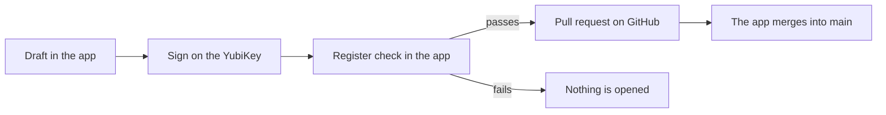

# Manuals

Step-by-step instructions for the FerroLICENCE app on the Mac, one task per
file, each following the app's screens. The design behind them is in
`../design.md`.

| Manual | For | When |
|---|---|---|
| [`00-what-to-buy.md`](00-what-to-buy.md) | the owners | before anything else: which YubiKey, how many, where |
| [`01-install.md`](01-install.md) | everyone | once per Mac |
| [`02-yubikey.md`](02-yubikey.md) | each owner, on their own Mac | once per YubiKey: create the master key on it and trust it |
| [`03-licences.md`](03-licences.md) | each owner | each time a customer gets, renews or loses a licence |
| [`04-check-and-attest.md`](04-check-and-attest.md) | everyone | to check a licence file, or to find whose licence made some data |
| [`05-lost-key.md`](05-lost-key.md) | the owners | when a YubiKey is lost, stolen or broken, or its holder hands over or leaves Cadasto |

## The roles

| Role | Holds | Can |
|---|---|---|
| **Owner** | one master key, created on their own YubiKey, and a row in `signers.json` with their GitHub login | issue, renew and revoke licences, set up a YubiKey, trust a new key, stop using a key |
| **Everyone else with access** | a GitHub account that can read the register's private repository | check licence files, attest data, read Activity |

There are two owners, the two business owners of Cadasto B.V. Each holds
one master key. The key is created on the YubiKey and never leaves it, so
there is no copy; the other owner's key is the backup. FerroEHR trusts both
public keys (`keys/*.asc`) and accepts a licence signed by either.
`../../signers.json` says who holds which key, so every licence in the
register names the person who signed it.

## How a change reaches the register

The app has no local copy of the repository. It reads the register from
GitHub, runs the Register check on every change, and records it as a pull
request that it merges itself. Nobody reviews it: the owner who drafted
and signed it is enough, and the merged pull request is the record.

No keyring ever enters the repository (`../../.claude/rules/secrets.md`).

## The order for a new owner

1. Buy a YubiKey (`00`).
2. Install GnuPG and the app, and sign in with GitHub (`01`).
3. Set up the YubiKey in the app (`02`).
4. FerroEHR's next release embeds the new `keys/` file.
5. From then on, issue licences (`03`).
